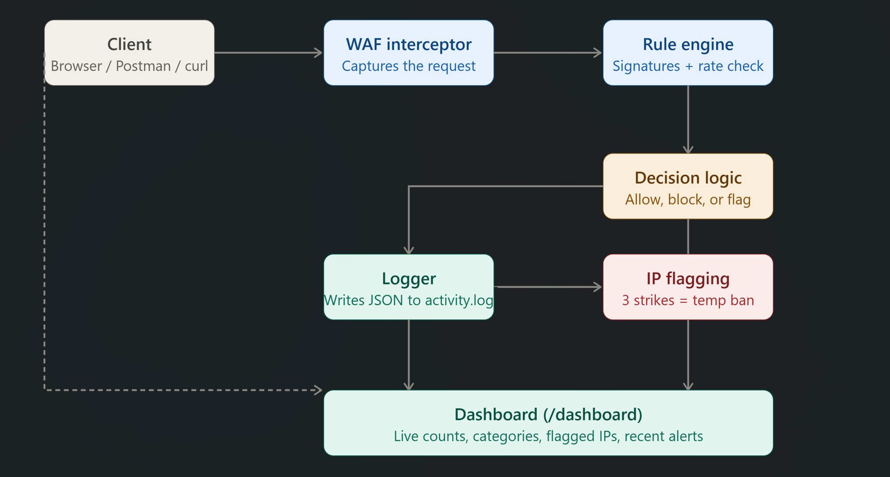
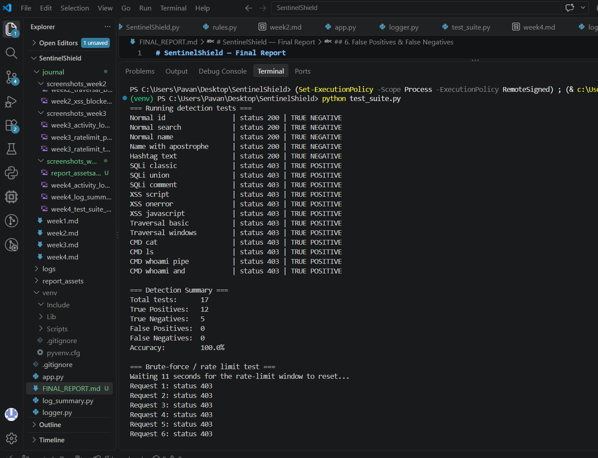
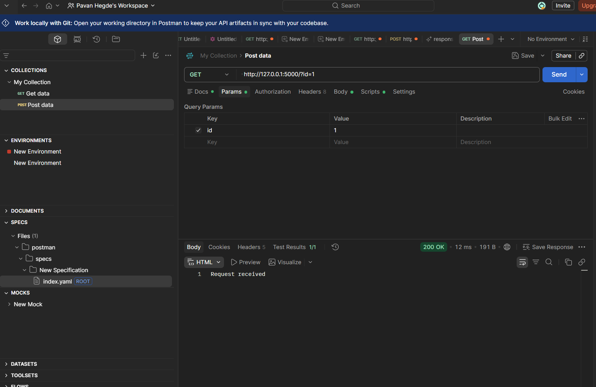
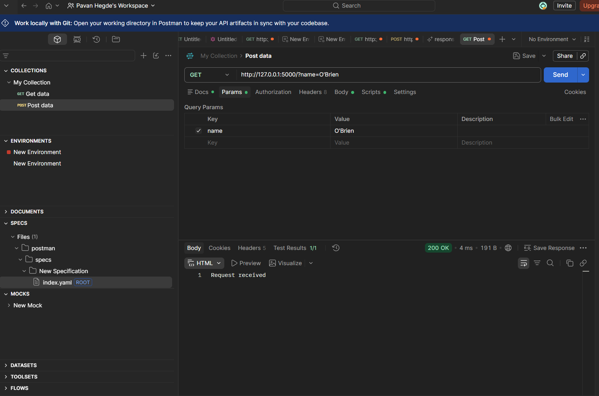
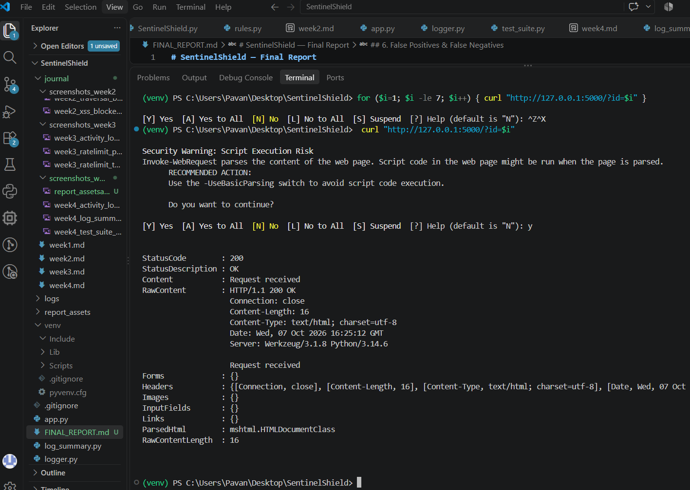
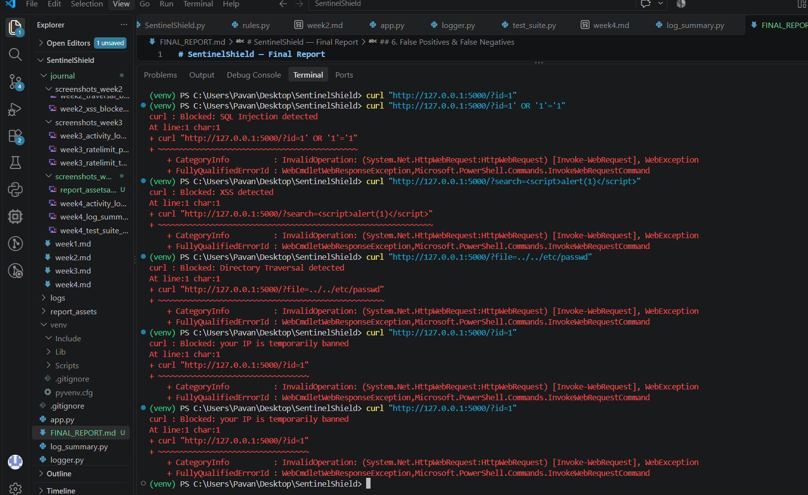
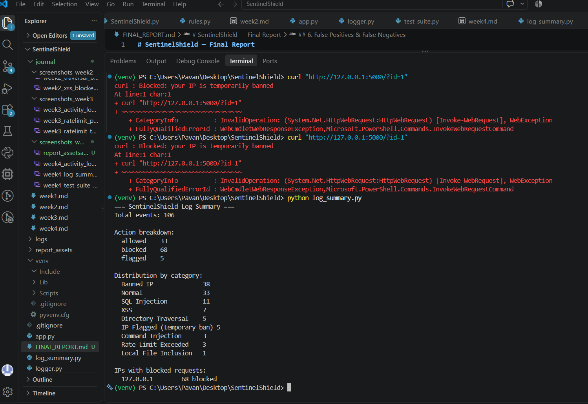
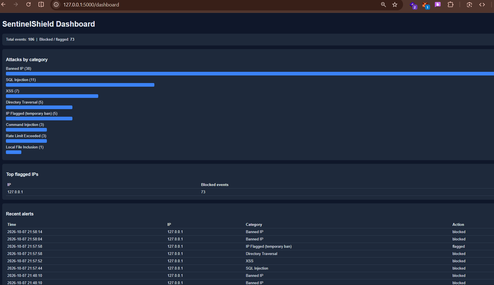
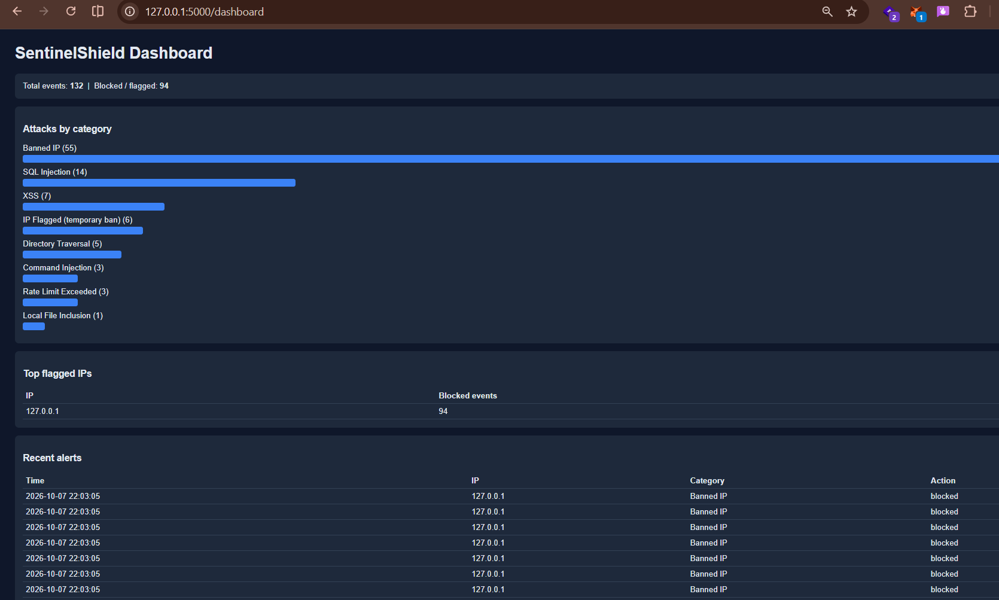

# SentinelShield — Final Report

## 1. Objective
SentinelShield is a simplified Web Application Firewall and Intrusion 
Detection System built to demonstrate how real-world WAFs detect threats 
using pattern/signature matching, monitor traffic behavior, log events, 
and surface results through a dashboard. This report summarizes the 
final system, its detection accuracy, and lessons learned.

## 2. System Architecture

The system intercepts every incoming request, checks it against the rule 
engine (signatures for SQLi, XSS, Directory Traversal, LFI, and Command 
Injection) and a rate-limit check. Based on the result, decision logic 
either allows the request or blocks it. Every event is logged, repeat 
offenders are flagged and temporarily banned, and all results are 
visualized on a live dashboard.

## 3. Tools & Technologies Used
- Python 3.x, Flask
- Regex-based rule engine
- Postman, curl / PowerShell
- Python `requests` library (automated test suite)
- VS Code, Git/GitHub

## 4. Test Summary
- Total attack requests tested: 34
- Total normal requests tested: 17
- Brute-force simulation requests sent: 12

## 5. Detection Accuracy — Before vs After Tuning

| Metric            | Before Tuning (Week 4) | After Tuning (Final Phase) |
|--------------------|:-----------------------:|:----------------------------:|
| True Positives      |           11           |              12              |
| True Negatives      |           3            |              5               |
| False Positives     |           2            |              0               |
| False Negatives     |           1            |              0               |
| **Accuracy (%)**    |           82.4%        |              100.0%          |

## 6. False Positives & False Negatives

**False Positives found:**
- `O'Brien` (apostrophe) incorrectly flagged as SQL Injection
- `#trending` incorrectly flagged as SQL Injection
- Fixed by requiring the quote/hash to appear near SQL keywords 
  (`or`, `and`, `--`) instead of matching any quote character alone.

**False Negatives found:**
- `&& whoami` was not detected as Command Injection
- Fixed by adding `&&` and backtick/`$()` patterns to the Command 
  Injection rule set.

## 7. Rate Limiting & IP Flagging Results
- Rate limit threshold: more than 5 requests in 10 seconds
- After 3 blocked/flagged events, the IP is temporarily banned for 60 seconds
- Confirmed working: sending 3 attack payloads in a row triggered a ban; 
  a subsequent normal request was blocked with "IP temporarily banned"; 
  access was restored after the ban period expired.

## 8. Log Analysis

| Category              | Count |
|-------------------------|:-------:|
| SQL Injection            |    11    |
| XSS                       |    7    |
| Directory Traversal       |   5     |
| Local File Inclusion      |   1      |
| Command Injection         |   3     |
| Rate Limit Exceeded       |   3    |
| IP Flagged (temp ban)     |   5     |
| Normal (allowed)          |   33    |

**Most flagged IP(s):** 127.0.0.1 (local testing environment)

## 9. Dashboard

The live dashboard is available at `http://127.0.0.1:5000/dashboard` and 
auto-refreshes every 5 seconds. It displays total events, a breakdown of 
attacks by category, the top flagged IPs, and the 10 most recent alerts.

## 10. Observed Patterns & Interpretation
(Write 4-6 sentences: what patterns stood out in the logs, how 
signature-based detection and rate-limiting complement each other, why 
the false positives happened, what the before/after accuracy comparison 
shows about rule tuning.)

## 11. Limitations
- IP tracking and bans are stored in memory and reset when the server restarts
- Regex-based rules can be bypassed by heavily obfuscated or encoded payloads
- Only GET/POST on a single route was tested; a production WAF would need 
  to cover all routes and methods
- Testing was done locally, so all traffic originates from one IP (127.0.0.1)

## 12. Future Improvements
- Persist IP bans and logs in a database instead of memory/flat file
- Add machine-learning-based anomaly detection alongside static rules
- Expand coverage to headers, cookies, and file uploads
- Add authentication to protect the `/dashboard` route

## 13. Conclusion
This project provided a practical understanding of how a Web Application Firewall (WAF) works in detecting and protecting web applications from malicious traffic. Throughout the project, the complete workflow of monitoring incoming requests, analyzing traffic patterns, identifying suspicious or malicious activities, and taking appropriate security decisions was studied and implemented.

The project demonstrated how different types of malicious requests, such as SQL Injection, Cross-Site Scripting (XSS), Local File Inclusion (LFI), and Command Injection, can be detected using predefined security rules and traffic analysis techniques. When suspicious activity is identified, the system can temporarily block or restrict the source of the malicious traffic and prevent further harmful requests.

The rate-limiting and IP-flagging mechanisms also provided an understanding of how repeated or abnormal requests can be detected and controlled. By combining detection rules, traffic monitoring, logging, and blocking mechanisms, the system is able to make security decisions based on the behavior of incoming requests.

Overall, the project helped in gaining practical knowledge of the WAF workflow and demonstrated how web traffic can be monitored, analyzed, detected, logged, and blocked when malicious behavior is identified. It also provided a better understanding of how security mechanisms work together to protect web applications from common attacks while maintaining visibility through structured logs and analysis.