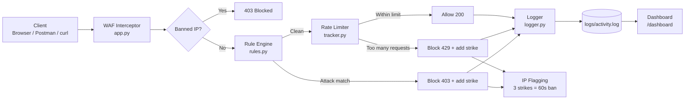

# SentinelShield

A lightweight **Web Application Firewall (WAF) and Intrusion Detection System** built with Python and Flask. It inspects every incoming HTTP request, detects common web attacks using signature rules, limits abusive traffic, logs every decision, and shows results on a live dashboard.

**Live demo:** https://sentinelshield-hypw.onrender.com/dashboard
**Full report:** [FINAL_REPORT.md](FINAL_REPORT.md)

---

## Features

- **Signature-based detection** for SQL Injection, XSS, Directory Traversal, Local File Inclusion, and Command Injection
- **Encoded payload detection** (for example `%3Cscript`, `%2e%2e/`)
- **Header and cookie scanning**, not just query parameters and body
- **Rate limiting**: more than 5 requests in 10 seconds is blocked (HTTP 429)
- **IP flagging**: 3 blocked events lead to a 60-second temporary ban
- **Structured JSON logging** (timestamp, IP, category, action)
- **Live dashboard** at `/dashboard` with attack counts, categories, flagged IPs, and recent alerts
- **Automated test suite** that measures detection accuracy, false positives, and false negatives

---

## Architecture




---

## Request Flow (what happens to every request)

1. **Client sends a request** (browser, Postman, or curl) to the Flask server.
2. **Interceptor captures it**: URL, query parameters, body, User-Agent, and Cookie.
3. **Ban check**: if the IP is temporarily banned, the request is rejected immediately.
4. **Rule engine scans the request** against attack signatures. A match returns `403`.
5. **Rate limiter counts requests per IP** in a 10-second window. Going over the limit returns `429`.
6. **Decision**: the request is allowed (`200`), blocked (`403` or `429`), or the IP is flagged.
7. **Logger records the event** as a JSON line in `logs/activity.log`.
8. **Dashboard reads the log** and displays live statistics.

---

## Detection Rules

| Category | Examples detected |
|---|---|
| SQL Injection | `' OR '1'='1`, `UNION SELECT`, `admin'--` |
| XSS | `<script>`, `onerror=`, `javascript:` |
| Directory Traversal | `../`, `..\`, `%2e%2e/` |
| Local File Inclusion | `/etc/passwd`, `win.ini`, `file://` |
| Command Injection | `; cat`, `&& whoami`, `` `id` ``, `$(...)` |

---

## Project Structure

```
SentinelShield/
├── app.py              # Flask app: interceptor, decision logic, dashboard
├── rules.py            # Regex attack signatures + check_request()
├── tracker.py          # Rate limiting, strikes, temporary IP bans
├── logger.py           # JSON event logging
├── test_suite.py       # Automated attack/normal request tests
├── log_summary.py      # Log analysis summary table
├── requirements.txt
├── FINAL_REPORT.md     # Full project report
├── journal/            # Weekly practical journals (week1-week4)
├── report_assets/      # Screenshots and diagrams
└── logs/               # Generated activity log
```

---

## How It Was Built (Project Flow, Start to End)

| Phase | What was done | Result |
|---|---|---|
| **Setup** | Installed Python, VS Code, Git, Postman; created venv, installed Flask, initialized Git | Working toolchain |
| **Week 1: Foundation** | Designed the architecture; built a basic Flask app that receives and prints requests; studied HTTP request anatomy | Request inspection working |
| **Week 2: Detection engine** | Built `rules.py` with regex signatures; connected it to Flask; found and fixed a false positive caused by scanning `str(dict)` | Attacks blocked with 403 |
| **Week 3: Behavior and logging** | Built `tracker.py` for per-IP rate limiting (429); built `logger.py` for JSON logs | Brute-force protection and audit trail |
| **Week 4: Testing and analysis** | Wrote `test_suite.py` to measure TP/TN/FP/FN; wrote `log_summary.py`; analyzed logs | Measured accuracy, found weaknesses |
| **Final phase: Tuning** | Fixed false positives and false negatives; added LFI, encoded payloads, header scanning; added IP flagging and the dashboard | Improved accuracy, full pipeline complete |
| **Delivery** | Wrote the final report and README; pushed to GitHub; deployed on Render; recorded a feedback video | Submitted |

Detailed weekly write-ups are in the [`journal/`](journal/) folder.

---

## Run Locally

```bash
git clone https://github.com/YOUR_USERNAME/SentinelShield.git
cd SentinelShield
python -m venv venv
venv\Scripts\activate
pip install -r requirements.txt
python app.py
```

The app runs at `http://127.0.0.1:5000`.

**Try it:**
```bash
curl "http://127.0.0.1:5000/?id=1"                       # allowed (200)
curl "http://127.0.0.1:5000/?id=1' OR '1'='1"            # blocked (403, SQL Injection)
curl "http://127.0.0.1:5000/?search=<script>alert(1)</script>"   # blocked (403, XSS)
curl "http://127.0.0.1:5000/?file=../../etc/passwd"      # blocked (403, Traversal)
```
Then open `http://127.0.0.1:5000/dashboard`.

**Run the test suite** (with the server running in another terminal):
```bash
python test_suite.py
python log_summary.py
```
Restart the server between test runs so bans and rate limits reset.

---

## Results

| Metric   Before tuning | After tuning |
|---|:---:|:---:|
| True Positives |   11  |       12     |
| True Negatives |   3   |       5      |
| False Positives |  2   |       0      |
| False Negatives |  1   |       0      |
| **Accuracy**   | 82.4% |      100.0   |

**Key fix:** a SQLi rule that flagged any single quote caused false positives on names like `O'Brien`. The rule now requires quotes to appear next to SQL logic (`OR`, `AND`, `--`).

---

## Screenshots

**Test suite output**


**Normal request allowed**


**False positive fixed (O'Brien)**


**Rate limit triggered**


**IP temporarily banned**


**Log summary**


**Live dashboard**


---

## Limitations

- Bans and rate-limit counters are stored in memory and reset when the server restarts.
- Regex rules can be bypassed by heavily obfuscated payloads.
- Only one route was protected and tested.
- The `/dashboard` route is not password protected.

## Future Improvements

- Store bans and logs in a database
- Add anomaly detection alongside static rules
- Cover file uploads and more HTTP methods
- Add authentication to the dashboard

---

## Tech Stack

Python, Flask, Regex, Postman, curl, Git/GitHub, Render