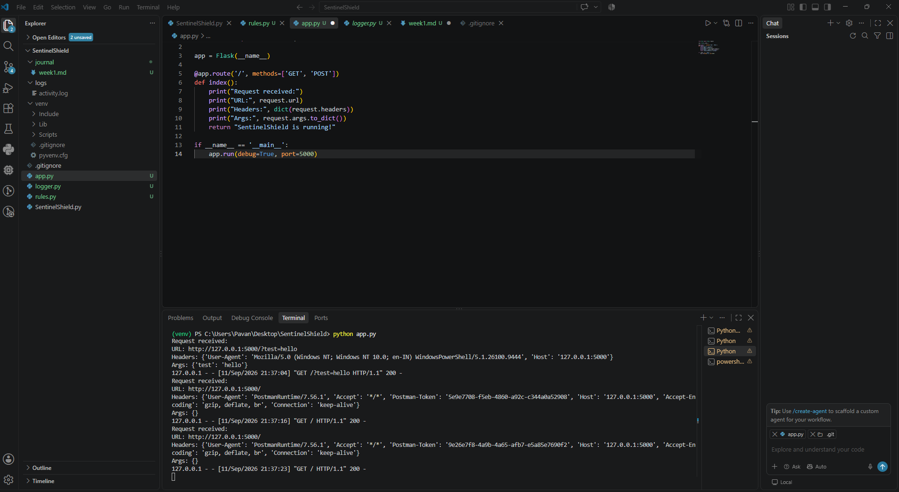
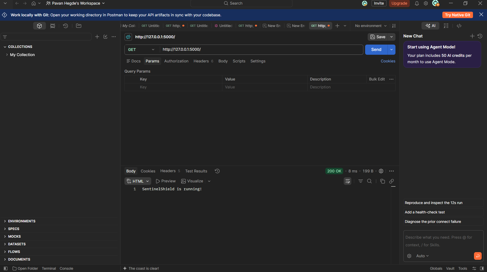
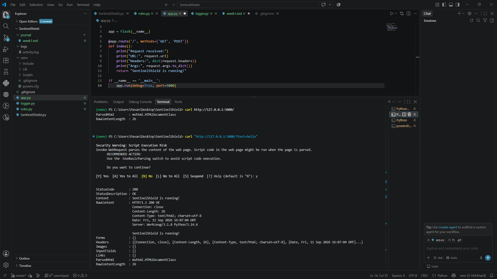

# Week 1 Journal — SentinelShield

## Purpose
This week's goal was to set up a basic Flask application and learn how to 
inspect HTTP requests — understanding headers, methods, and payloads as a 
foundation for building security-focused tooling.

## Tools Used
- Python
- Flask
- curl
- Postman
- Git

## Steps Followed
1. Set up a Python virtual environment (`venv`) for the project.
2. Installed Flask (`pip install flask`).
3. Created a basic Flask app with a test route (`/`) to confirm the server runs.
4. Ran the Flask development server and tested it in the browser.
5. Sent test requests using `curl` from the terminal to inspect responses.
6. Used Postman to send GET/POST requests and examine headers, status codes, 
   and response bodies in more detail.
7. Compared request/response structure across curl, Postman, and the browser.

## What I Learned About Request Structure
- HTTP requests consist of a method (GET, POST, etc.), headers, and 
  optionally a body.
- Postman makes it easy to visually inspect headers and status codes, 
  while curl is faster for quick command-line checks.
- Flask's terminal output logs each incoming request, which is useful 
  for debugging.
- (Add anything else specific to what you noticed this week.)