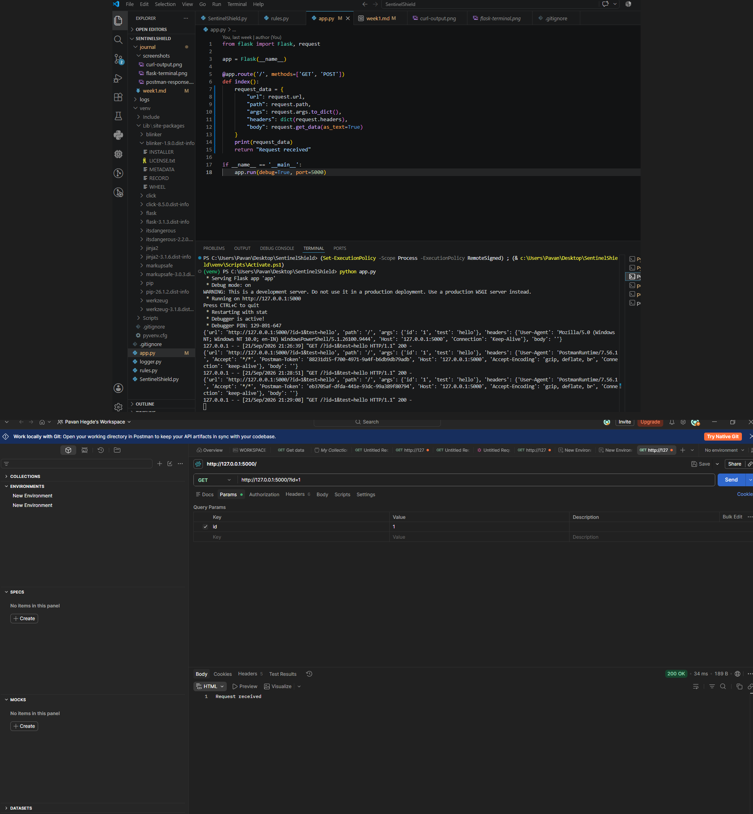
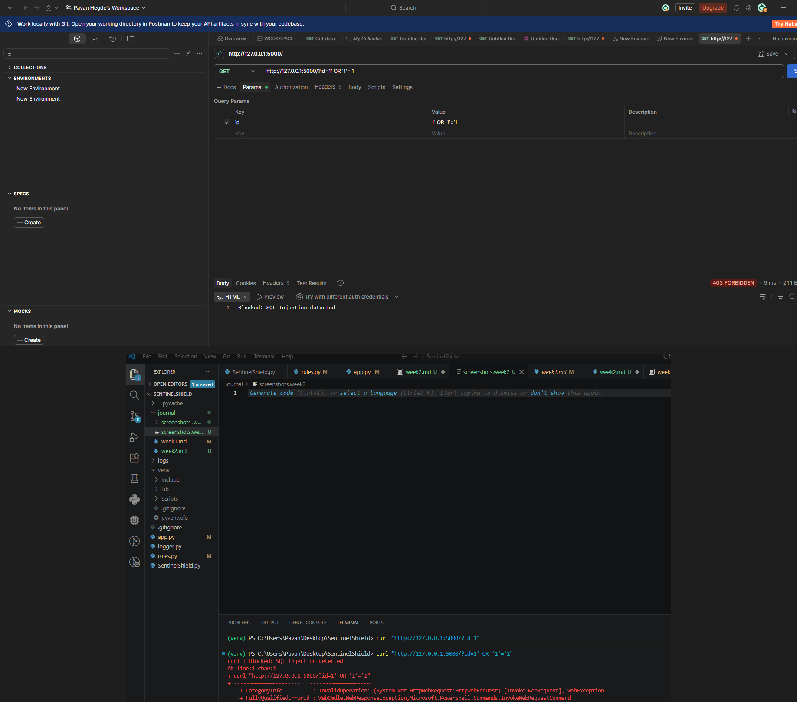
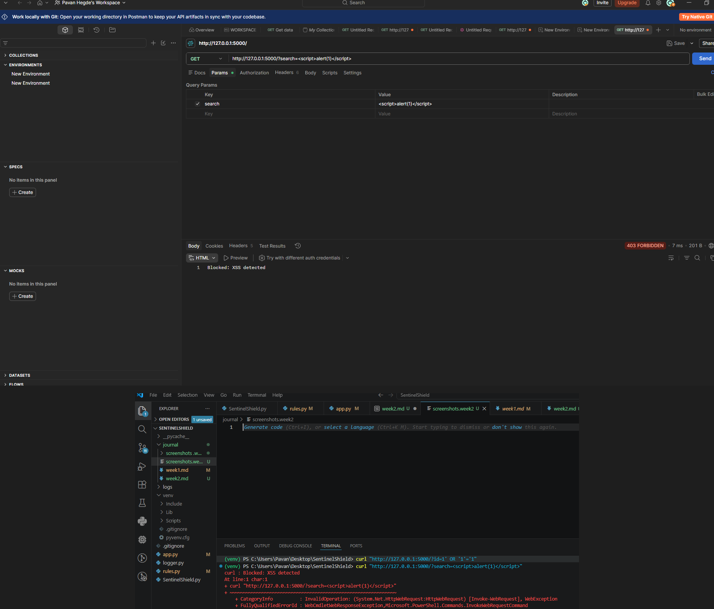
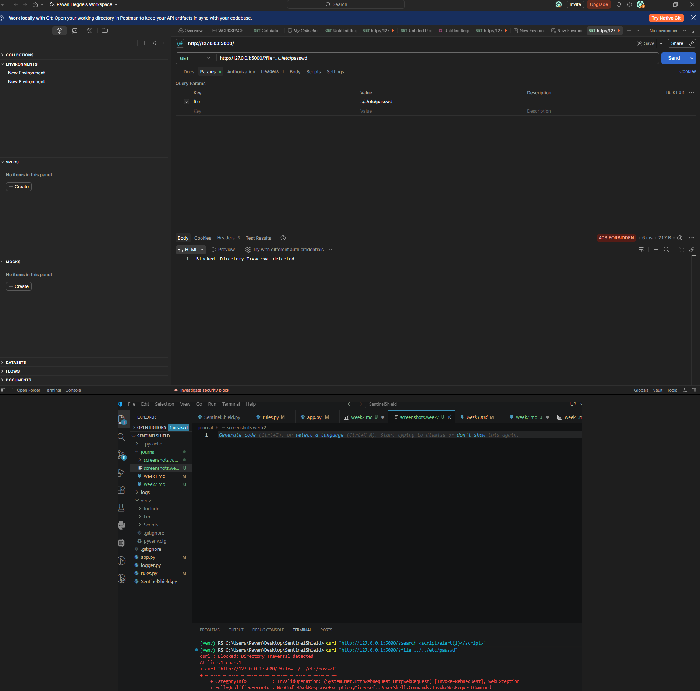
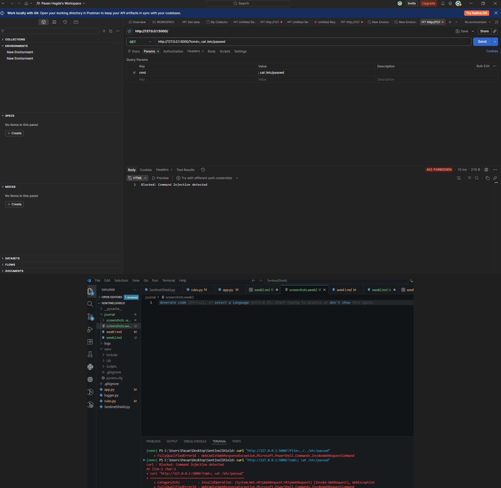

# Week 2 — Rule-Based Detection Engine

## Purpose
The goal of Week 2 was to move beyond simply receiving HTTP requests and 
build a rule-based detection engine capable of identifying common web 
attacks — SQL Injection, XSS, Directory Traversal, and Command Injection 
— inside incoming requests.

## Tools Used
- Python 3.x
- Flask (web server / request interceptor)
- Postman (manual request testing)
- curl (command-line request testing)
- VS Code (development environment)
- Git (version control)

## Steps Performed
1. Restructured `app.py` to organize incoming request data into a clean 
   dictionary containing url, path, args, headers, and body.
2. Created `rules.py` containing regex-based attack signatures grouped 
   into four categories: SQL Injection, XSS, Directory Traversal, and 
   Command Injection.
3. Wrote a `check_request()` function that scans input text against all 
   defined rules and returns the matched attack category, or None if clean.
4. Integrated `check_request()` into the Flask route so every incoming 
   request is checked before a response is returned.
5. Tested the system using both curl and Postman with normal and malicious 
   payloads.

## Observations
- Initial testing revealed a **false positive**: even a harmless request 
  like `?id=1` was being blocked as "SQL Injection."
- Root cause: the detection function was scanning the entire Python 
  dictionary as a string (`str(request_data)`), and Python's own 
  dictionary formatting wraps keys/values in single quotes — which 
  matched the SQL Injection rule for the `'` character, regardless of 
  user input.
- Fixed by scanning only the actual user-controlled input (URL path, 
  query argument values, and body) instead of the entire dictionary 
  structure.
- After the fix:
  - Normal request (`?id=1`) → returned `200 Request received` ✅
  - SQL Injection payload (`?id=1' OR '1'='1`) → returned 
    `403 Blocked: SQL Injection detected` ✅
  - XSS payload (``) → correctly blocked ✅
  - Directory traversal payload (`../../etc/passwd`) → correctly blocked ✅
  - Command injection payload (`; cat /etc/passwd`) → correctly blocked ✅

## Interpretation
This week's biggest learning was that **false positives can come from 
the detection code itself, not just weak rules** — in this case, 
Python's default string conversion of a dictionary accidentally 
introduced characters that matched a rule. This reinforced the 
importance of carefully choosing *what* data gets scanned, not just 
*how* it gets scanned.

The rule-based approach worked correctly for all four attack categories 
once the input was properly isolated. However, the current rules use a 
small number of static patterns, so more sophisticated or obfuscated 
attack payloads (e.g., encoded SQLi, case variations, or alternate XSS 
vectors) may not yet be caught — this is expected to improve as more 
rules are added in later weeks.

## Screenshots

### Normal request (200 OK)

### SQL Injection blocked (403)

### XSS blocked (403)

### Directory Traversal blocked (403)

### Command Injection blocked (403)
