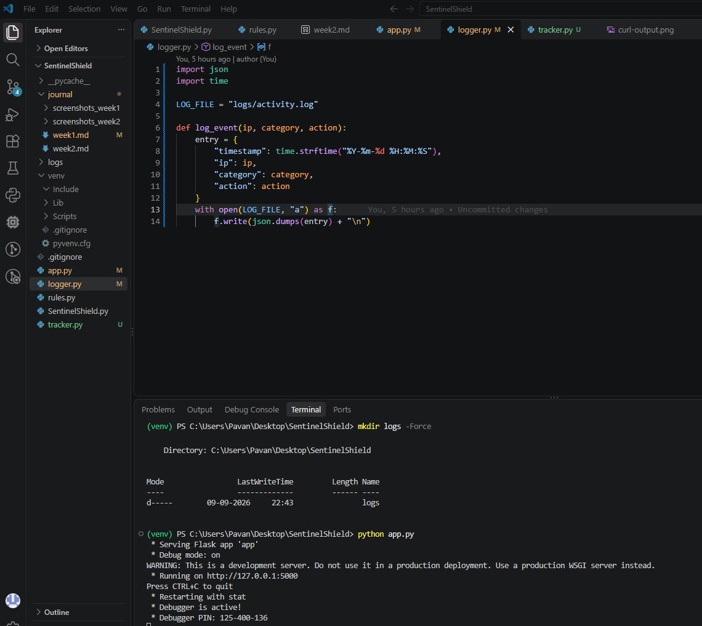
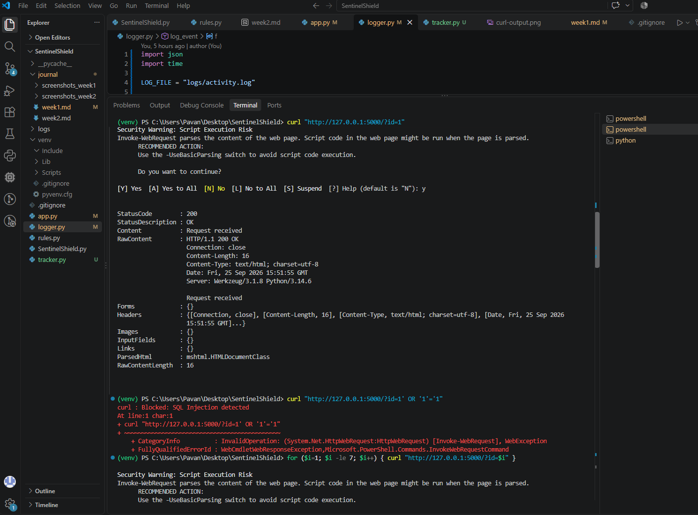
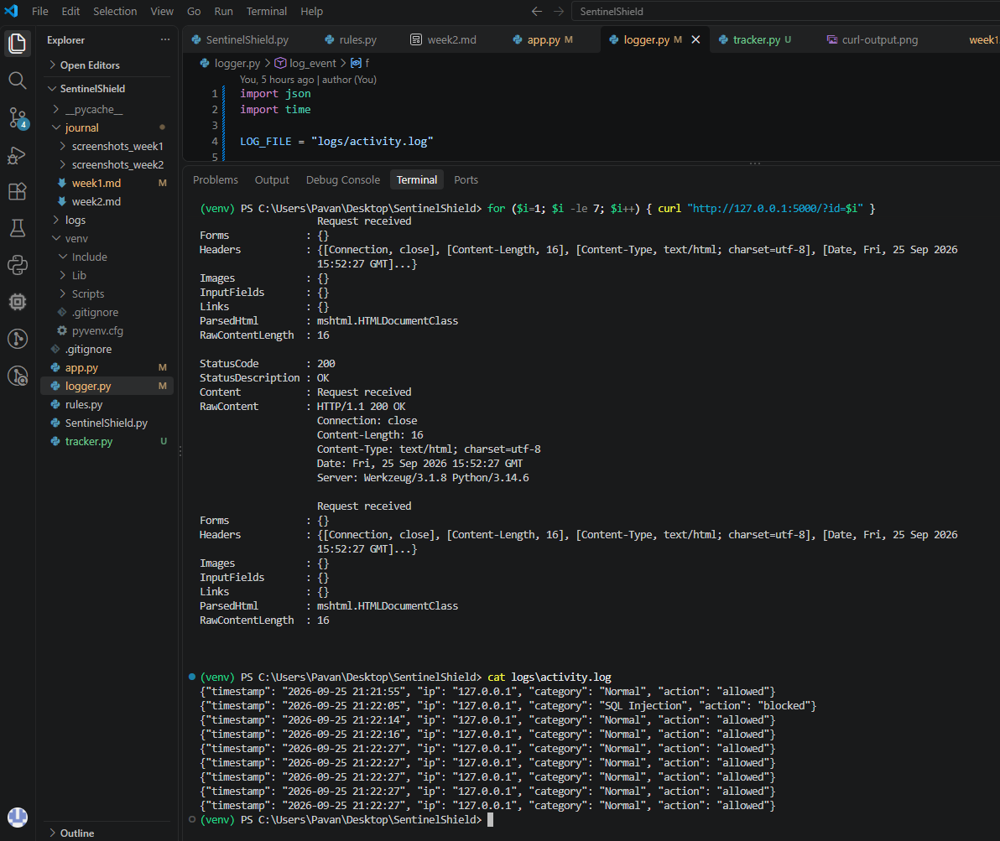

# Week 3 — Traffic Monitoring, Rate Limiting & Alerting

## Purpose
Add behavior-based detection to SentinelShield by tracking requests per IP 
and flagging abusive traffic (brute-force/flooding patterns), in addition 
to the signature-based rule engine built in Week 2. Also implemented 
structured logging so every event is recorded for later analysis.

## Tools Used
Python, Flask, Postman, curl/PowerShell, VS Code, Git

## Steps Performed
1. Built tracker.py to record request timestamps per IP within a rolling time window
2. Set threshold: more than 5 requests in 10 seconds triggers abuse flag
3. Integrated is_abusive() into app.py — returns 429 when threshold exceeded
4. Built logger.py to write structured JSON log entries (timestamp, IP, category, action)
5. Tested with normal traffic, malicious payloads, and rapid repeated requests

## Observations
- Normal single requests passed with 200
- SQLi payload correctly blocked (403) and logged
- Sending 7 rapid requests: first 5 passed (200), remaining 2 blocked (429) 
  with "Rate Limit Exceeded" logged
- activity.log correctly captured all three event types with timestamps

## Interpretation
This week's work showed how behavior-based detection differs from 
signature-based detection — rate limiting doesn't look at the *content* 
of requests, only their *frequency* per IP. This is effective against 
brute-force and flooding attacks that use "normal-looking" payloads which 
signature rules alone wouldn't catch. Logging every decision (not just 
blocked ones) also proved useful, since it lets us calculate detection 
accuracy and false positive/negative rates later in the final report.

## Screenshots

