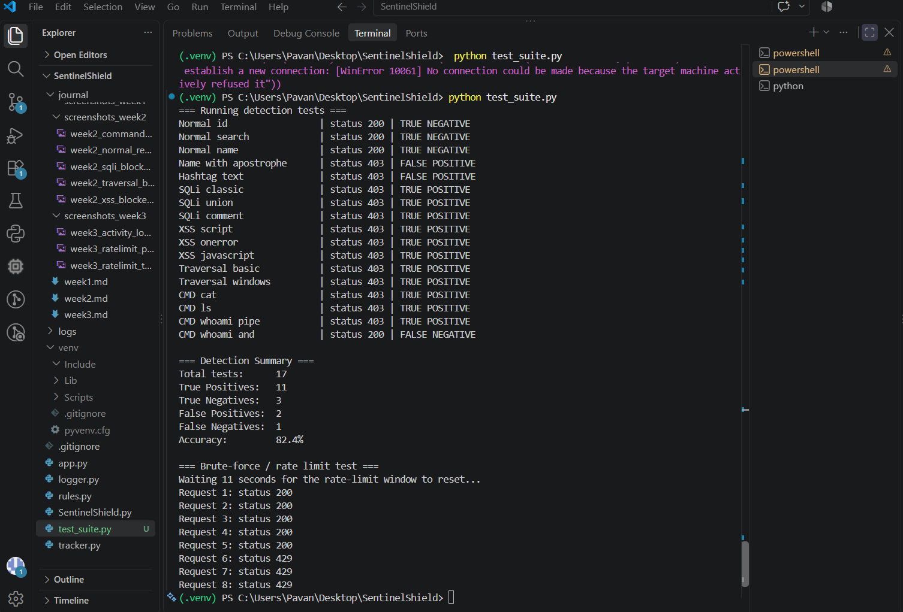
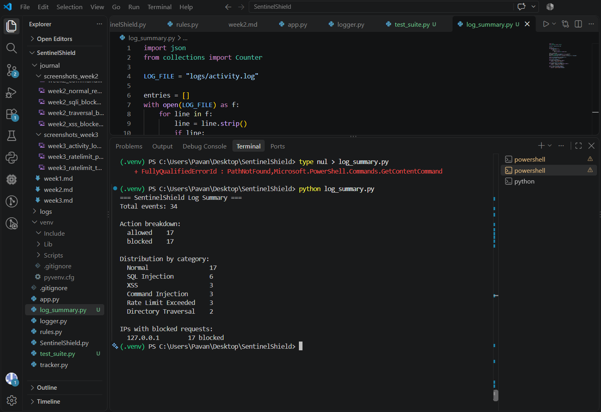
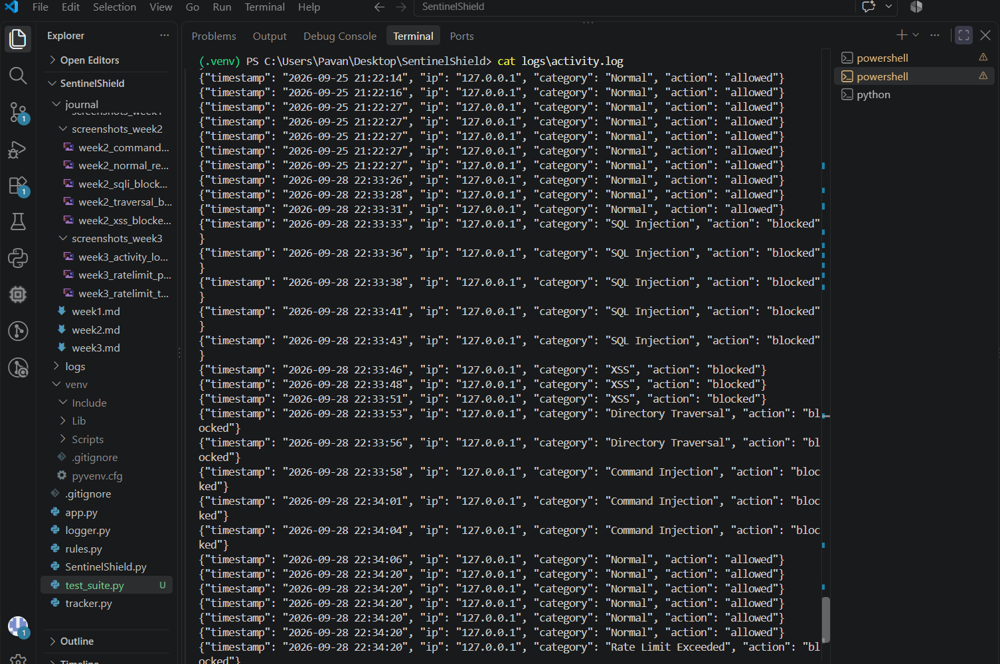

# Week 4 — Testing, Log Analysis & Reporting Prep

## Purpose
This week focused on stress-testing the SentinelShield detection engine 
built in Weeks 2 and 3, measuring its accuracy using an automated test 
suite, and analyzing the resulting logs to produce a summary of attack 
patterns and detection performance.

## Tools Used
Python, Flask, requests (Python library), VS Code, Git

## Steps Performed
1. Wrote `test_suite.py` to automatically send a mix of normal and 
   malicious requests to the Flask server.
2. Classified each result as True Positive, True Negative, False 
   Positive, or False Negative based on expected vs. actual outcome.
3. Calculated overall detection accuracy from the test results.
4. Ran a brute-force simulation to confirm rate limiting still works 
   correctly under the test suite.
5. Wrote `log_summary.py` to parse `activity.log` and generate a 
   summary table: total events, category distribution, and flagged IPs.
6. Manually reviewed the raw log file to identify patterns.

## Test Results

| Metric            | Count |
|-------------------|-------|
| Total tests run   |   17    |
| True Positives     |  11   |
| True Negatives     |  3     |
| False Positives    |  2     |
| False Negatives    |  1     |
| Accuracy (%)       |  82.4%     |

## Log Summary

| Category              | Count |
|------------------------|-------|
| SQL Injection          |   6    |
| XSS                    |   3    |
| Directory Traversal    |   3    |
| Command Injection      |   3    |
| Rate Limit Exceeded    |   2    |
| Normal (allowed)       |   17    |

**Most flagged IP(s): 70.77%

## Observations
- i tracked a  attacking  tatcices and techniques  and i got how they actuall blocked in a firewalls 
-  i also got how the WAFs actualldo got them and catches within in normal traffics
- 

## False Positives Found
a rule looking for OR 1=1 might also block a legit search query containing or and numbers
- 

## False Negatives Found
A false negative = an actual attack that got through undetected

- 

## Interpretation
usually ragex matced a known/comman attacks signature exatly
also the regex is a pattern-matching techniques
(after X requests/sec or X failed logins)? Did it fully stop the attack or just slow it down

## Screenshots

